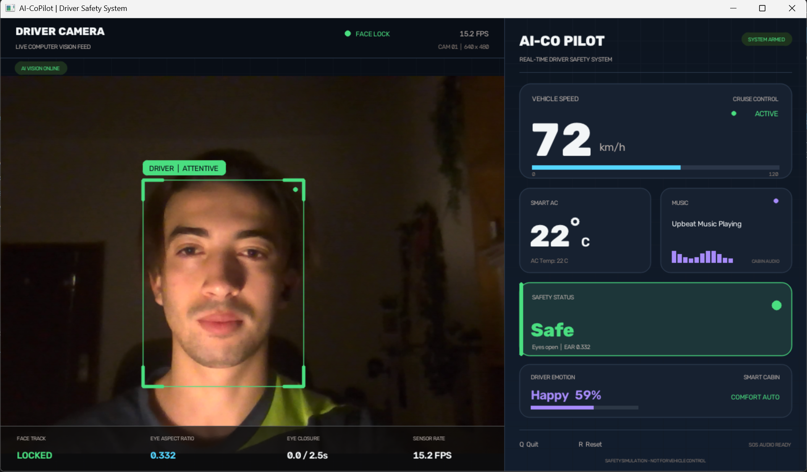
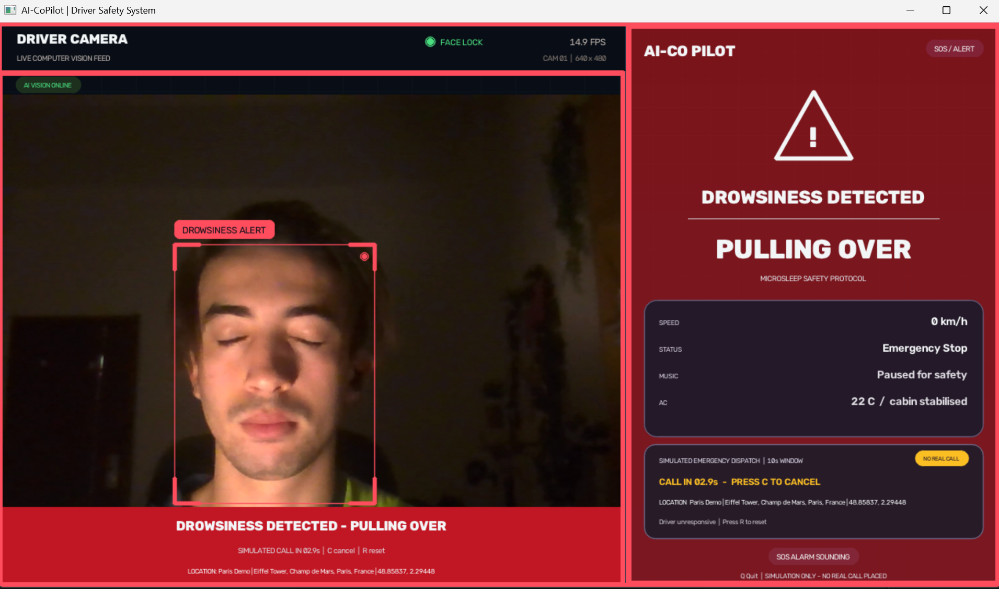
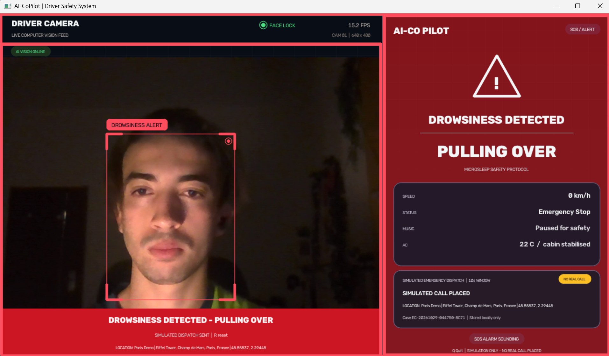

# AI-CoPilot

**A real-time, webcam-powered driver monitoring and automotive safety simulation.**

AI-CoPilot turns a laptop webcam into a smart-car cockpit display. It watches the
driver's face, measures eye openness with MediaPipe's Face Landmarker (the modern
478-point Face Mesh task), reads facial emotion with DeepFace, and uses those signals
to drive a live OpenCV dashboard. When the driver's eyes stay closed for more than
2.5 seconds, the system treats it as a microsleep: it sounds a looping alarm, flashes
the cockpit red, and brings the simulated vehicle to an emergency stop.

> **Safety notice:** AI-CoPilot is an educational computer-vision simulation. It is
> not a certified drowsiness-detection device, advanced driver-assistance system
> (ADAS), or substitute for a rested driver. Do not connect it to a real vehicle's
> controls.

> **Emergency-dispatch simulation:** The emergency dispatch workflow is a local
> simulation. AI-CoPilot does **not** call public emergency services, connect to a
> telephone network, or transmit your location or camera imagery anywhere. It reads
> the location you configure, shows the simulated dispatch on screen, and writes a
> local incident record.



*Live cockpit: face tracking, EAR, simulated vehicle state, emotion-aware music, and
smart climate control.*

---

## Highlights

- **Live driver feed** with a tracked face box and an in-frame vision HUD.
- **Eye Aspect Ratio (EAR)** computed from MediaPipe Face Landmarker landmarks every frame.
- **Temporal drowsiness logic** with a 2.5-second closure threshold and manual reset.
- **DeepFace emotion recognition** running every three seconds on a background thread.
- **Emotion-aware cabin audio** — upbeat for happiness, relaxing for sadness or anger.
- **Smart climate control** — angry or stressed drivers get an automatic 2 °C cooldown.
- **Emergency protocol** — looping Pygame siren, flashing red dashboard, zero speed,
  and `Emergency Stop` status.
- **Simulated emergency dispatch** — a 10-second cancel window, the configured driver
  location, and a local JSONL incident record. **No real call is placed and no data
  leaves the machine.**
- **Graceful degradation** — the dashboard keeps rendering if emotion analysis or audio
  is unavailable, and the app can run with `--no-emotion` on lower-spec machines.
- **Local by design** — frames are processed in memory and never uploaded. Emergency
  profiles and incident logs stay in the project folder.

---

## What the dashboard shows

| Panel | Behaviour |
|---|---|
| **Speed** | A simulated cruise accelerates from 0 to 72 km/h. It immediately drops to 0 during an emergency stop. |
| **AC Temp** | Starts at 22 °C. Moves to 20 °C when anger or the stress proxy is detected, then returns to 22 °C after the expression clears. |
| **Music** | `Upbeat Music Playing` for happy, `Relaxing Music Playing` for sad or angry, and a focus/ambient playlist for other expressions. |
| **Status** | `Safe`, `Drowsy`, `No Driver`, or `Emergency Stop`. |
| **Driver Emotion** | Dominant DeepFace emotion with confidence and the active smart-cabin response. |
| **Emergency Dispatch** | During an emergency: countdown, simulated dispatch, cancellation state, configured location, and local case ID. |
| **Vision HUD** | Face lock state, EAR, eye-closure timer, and render rate. |

A short eye blink does not trigger the alarm. The closure timer only starts after the
media-filtered EAR remains below the threshold; if the driver opens their eyes (or
the face is lost), the timer resets. After a full 2.5 seconds of closure, the alarm
latches and the car remains stopped until **R** is pressed.

The music panel simulates an infotainment state; it does not stream songs. Pygame is
used for the audible SOS siren.

### Emergency dispatch in action

These captures show the local simulation using the demo "Paris Demo" profile. The
countdown can be cancelled with **C**; after it expires, the record is written locally.

| 10-second cancellation window | Simulated dispatch completed |
|---|---|
|  |  |

---

## How it works

```text
                 +-----------------------+
  Webcam frame ->| OpenCV capture/mirror |----> live feed + face box
                 +-----------+-----------+
                             |
                 +-----------v-----------+
                 | MediaPipe Face        |
                 | Landmarker (478 pts)  |
                 +-----+-----------+-----+
                       |           |
                 EAR calculation   |
                       |           |
             +---------v----+      |      +------------------------+
             | Temporal EAR |      +----->| Face crop (every 3 s)  |
             | median + 2.5 s|            | DeepFace background    |
             | state machine |            | worker                 |
             +------+--------+            +-----------+------------+
                    |                                 |
            alarm / emergency                 emotion + confidence
                    |                                 |
                    +--------------+------------------+
                                   v
                        +----------------------+
                        | OpenCV cockpit UI    |
                        | speed / AC / music   |
                        | status / SOS overlay |
                        +----------------------+
```

### 1. Computer vision: eye aspect ratio

MediaPipe's Face Landmarker returns a dense 478-point mesh for each detected face. For
each eye, AI-CoPilot uses six points: one at each corner and two on each eyelid. The
Eye Aspect Ratio is:

```text
EAR = (||p2 - p6|| + ||p3 - p5||) / (2 * ||p1 - p4||)
```

When the eye is open, the vertical distances are large and EAR typically sits around
0.25-0.35. As the eyelid closes, the numerator collapses toward zero. AI-CoPilot uses
a median of the last three frames to reject single-frame landmark jitter, then compares
that value with a configurable threshold (default **0.21**). A closure must persist for
**2.5 seconds** before it is classified as a microsleep. This delay avoids false alarms
from normal blinking while still responding to prolonged eye closure.

### 2. Deep learning: facial affect in the cabin

DeepFace runs a pre-trained emotion classification model on a cropped face image. It
returns scores for happy, sad, angry, neutral, fear, disgust, and surprise. AI-CoPilot
converts those into cabin actions:

- **Happy** -> upbeat music.
- **Sad / angry** -> relaxing music.
- **Angry / fear / disgust**, or a high angry/fear score -> stress proxy active, which
  tunes the simulated AC target from 22 °C to 20 °C.
- **Neutral / surprise** -> focus or ambient driving playlist.

DeepFace can take a noticeable fraction of a second on CPU, so it never runs on the
render thread. A single background worker receives the latest face crop at most once
every three seconds. If the model is still busy, older requests are dropped and only
the newest frame is analyzed. The OpenCV window therefore stays responsive.

The "stress" signal is a design mapping: DeepFace does not expose a dedicated stress
class, so fear and disgust are treated as stress proxies, and elevated angry/fear
probabilities can also trip the cooling response. This is intentionally documented
rather than presented as a clinical measurement.

### 3. Automotive safety state machine

| Input | Cabin response |
|---|---|
| Face present, eyes open | `Safe`; simulated cruise continues |
| Face absent | `No Driver`; no alarm, vision HUD reports searching |
| EAR low for 0.4-2.5 s | `Drowsy`; amber warnings and closure countdown |
| EAR low for 2.5 s | Siren loops, dashboard flashes red, speed set to 0, `Emergency Stop`, `PULLING OVER` overlay, and a 10-second simulated dispatch countdown starts |
| Driver presses **C** during the countdown | Simulated call is cancelled; the drowsiness alarm and emergency stop remain active |
| Driver presses **R** | Alarm silenced, state machine and dispatch state cleared, simulation resumes from 0 km/h |

Keeping the emergency latched until a manual reset mirrors a pull-over workflow: the
system does not assume that a driver who briefly opens their eyes is fit to continue.

### 4. Simulated emergency dispatch and location handoff

Real emergency calling needs a regulated service, consent, redundant sensors, and a
production escalation policy. AI-CoPilot demonstrates the *workflow* without placing a
real call:

1. When the drowsiness alarm latches, the local dispatch agent is armed and starts a
   configurable countdown (10 seconds by default).
2. The dashboard shows the configured driver location, the remaining time, and
   **NO REAL CALL**. Press **C** to cancel the simulated call. The siren stays active.
3. If the countdown completes, the app generates a local case ID, displays
   `SIMULATED CALL PLACED`, and appends an incident record to
   `incidents/emergency_incidents.jsonl`. Press **R** to reset the full emergency state.
4. If the camera stream drops during the countdown, the countdown continues. The
   emergency stop remains latched.

There is **no network request, telephone integration, SMS, or external location
sharing** anywhere in this workflow. The "dispatch" is a UI simulation plus a local log
file. The camera banner and emergency dashboard both say `SIMULATION ONLY - NO REAL CALL
PLACED` so the behaviour cannot be mistaken for a real emergency service.

Configure the location in `emergency_config.json` in the project root. Use a street
address or a recognizable landmark; coordinates are optional but must be supplied as a
valid latitude/longitude pair:

```json
{
  "driver_name": "Driver",
  "location": {
    "label": "Home",
    "address": "221B Baker Street, London",
    "latitude": 51.52377,
    "longitude": -0.15853
  },
  "dispatch_delay_seconds": 10
}
```

The file is created from a template on first run if it is missing. While the address
still contains the template text and no coordinates are set, the dashboard shows
`LOCATION NOT CONFIGURED - EDIT EMERGENCY_CONFIG.JSON` in amber. Coordinates outside
`-90..90` / `-180..180`, incomplete coordinate pairs, and delays outside 1-60 seconds
are ignored or clamped. The delay cannot remove the initial cancellation window.

`emergency_config.json` and `incidents/` are excluded by `.gitignore` because they can
contain personal location information. Treat both as private local data.

---

## Project structure

```text
AI-CoPilot/
|-- copilot.py                 # capture, AI, dispatch state machine, audio, OpenCV UI
|-- emergency_config.json      # local driver/location profile (private, gitignored)
|-- README.md
|-- requirements.txt
|-- .gitignore
|-- assets/
|   |-- face_landmarker.task   # MediaPipe Face Landmarker model (~3.6 MB)
|   `-- alarm.wav              # two-tone siren, generated on first alarm startup
|-- docs/
|   `-- screenshots/           # README screenshots
|       |-- dashboard-safe.png
|       |-- emergency-countdown.png
|       `-- emergency-dispatched.png
|-- incidents/
|   `-- emergency_incidents.jsonl  # local simulated-dispatch records (private)
`-- .venv/                     # Python 3.12 virtual environment
```

---

## Requirements

- Windows, macOS, or Linux with a webcam and an audio output device.
- **Python 3.10-3.12** (Python 3.12 is used here; MediaPipe does not yet publish
  wheels for Python 3.13/3.14).
- Internet access on the first DeepFace run so it can download its model weights.
  Afterward, analysis is fully local.
- A reasonably modern CPU. DeepFace is the heaviest component; the app can run
  without it using `--no-emotion`.

Python packages:

```text
opencv-python==5.0.0.93
mediapipe==1.1.1
deepface==0.0.103
numpy==2.5.4
pygame==2.6.1
werkzeug==3.1.9
```

`werkzeug` is included explicitly because DeepFace 0.0.103 imports it without
declaring it as a required dependency in every distribution. The exact tested versions
are pinned in `requirements.txt`.

---

## Installation

The project, virtual environment, and dependencies are already prepared on this
machine. To recreate the environment elsewhere:

### Windows (Command Prompt)

```bat
cd %USERPROFILE%\Desktop\AI-CoPilot
py -3.12 -m venv .venv
.venv\Scripts\activate
python -m pip install --upgrade pip
python -m pip install -r requirements.txt
```

### Windows (PowerShell)

```powershell
cd $HOME\Desktop\AI-CoPilot
py -3.12 -m venv .venv
.\.venv\Scripts\Activate.ps1
python -m pip install --upgrade pip
python -m pip install -r requirements.txt
```

If PowerShell blocks activation, call the interpreter directly, as shown below.

### macOS / Linux

```bash
cd ~/Desktop/AI-CoPilot
python3.12 -m venv .venv
source .venv/bin/activate
python -m pip install --upgrade pip
python -m pip install -r requirements.txt
```

---

## Run it

From this project on this machine, the exact command is:

```bat
C:\Users\Lenovo\Desktop\AI-CoPilot\.venv\Scripts\python.exe C:\Users\Lenovo\Desktop\AI-CoPilot\copilot.py
```

Or, from inside the project folder:

```bat
cd /d C:\Users\Lenovo\Desktop\AI-CoPilot
.venv\Scripts\python.exe copilot.py
```

PowerShell:

```powershell
cd $HOME\Desktop\AI-CoPilot
.\.venv\Scripts\python.exe .\copilot.py
```

The first start can take a little longer while MediaPipe and DeepFace initialize. Both
model files are cached locally: the Face Landmarker task model is already in `assets/`
and is re-downloaded only if it is missing, while the DeepFace emotion weights download
on the first scan. Wait for the dashboard emotion panel to leave "Calibrating...", then
look directly at the camera.

### Controls

| Key | Action |
|---|---|
| **Q** or **Esc** | Quit |
| **C** | Cancel the pending simulated emergency dispatch; the alarm stays active |
| **R** | Reset after an emergency stop, clear dispatch state, and resume the simulation |

### Optional arguments

```bat
.venv\Scripts\python.exe copilot.py --help
```

| Flag | Purpose |
|---|---|
| `--camera 1` | Select another camera if index 0 is the wrong or virtual device |
| `--ear-threshold 0.21` | Tune eye-closure sensitivity |
| `--drowsy-seconds 2.5` | Change the sustained-closure alarm delay |
| `--no-emotion` | Disable DeepFace to reduce CPU and memory use |
| `--mute` | Keep the visual alarm but disable the siren |
| `--no-mirror` | Show the raw, unmirrored webcam feed |

---

## First-run notes

1. **Model downloads.** The MediaPipe Face Landmarker model is bundled in `assets/`
   (and can be re-fetched automatically). DeepFace downloads its pre-trained ONNX
   emotion weights once and caches them under your user profile. The first analysis
   can take 10-60 seconds depending on the network, while later scans are much faster.
2. **Camera permissions.** On Windows, allow desktop apps to use the camera under
   *Settings > Privacy & security > Camera*. Close Teams, Zoom, or other applications
   that may hold the camera exclusively.
3. **Alarm audio.** `assets/alarm.wav` is synthesized locally from a two-tone siren on
   first use. Pygame initializes only the audio mixer, not a game window.
4. **Performance.** If the feed feels sluggish, run with `--no-emotion` and leave the
   drowsiness pipeline active. MediaPipe Face Landmarker is fast enough for a normal
   laptop.
5. **Emergency profile.** Before relying on the location display in a demo, edit
   `emergency_config.json` with your own label and address. The template is deliberately
   flagged as unconfigured, and the dashboard will tell you so. Dispatch remains
   simulated regardless of the values in this file.

---

## Troubleshooting

| Symptom | Fix |
|---|---|
| `Could not open camera index 0` | Try `--camera 1`, close other camera apps, check Windows camera privacy settings. |
| Dashboard opens but emotion stays on "Calibrating..." | The first DeepFace model load can be slow. Watch the console for errors; ensure internet access for the initial model download. |
| `MediaPipe Face Landmarker could not start` | Confirm you are using Python 3.12, not 3.13/3.14, reinstall `mediapipe`, and make sure `assets/face_landmarker.task` exists. |
| No alarm audio | Check the system output device and volume. The dashboard shows `SOS AUDIO OFFLINE` if Pygame could not open an audio device. Use `--mute` to suppress the warning. |
| False drowsiness alerts | Improve front lighting, remove strong backlight, and try a lower `--ear-threshold` such as `0.18`. |
| Alarm never fires | Raise `--ear-threshold` slightly (up to about `0.24`) and verify the vision HUD shows a plausible EAR while your eyes are open. |
| Very low frame rate | Use `--no-emotion`. Close CPU-heavy applications. A 640x480 camera is sufficient. |
| `LOCATION NOT CONFIGURED` on the emergency screen | Edit `emergency_config.json` and replace the template address (or add a latitude/longitude pair), then restart the app. |
| No incident record after the countdown | Confirm the project folder is writable and inspect the console for a `[dispatch] Could not write incident log` message. The simulation is local and does not require internet access. |
| ONNX/DeepFace import error on Windows | Install the Microsoft Visual C++ Redistributable, then recreate the venv with Python 3.12 and reinstall the requirements. Run with `--no-emotion` to keep the drowsiness system working while troubleshooting. |

---

## Privacy and ethical use

- Video frames are consumed in memory only. AI-CoPilot does not record, save, or
  transmit camera imagery.
- DeepFace downloads public model weights on first use; emotion analysis after that is
  local.
- The emergency-dispatch feature is a **simulation**. It does not call emergency
  services, send messages, or share your location with any server or person. It cannot
  summon help.
- `emergency_config.json` stores a location you provide. When a simulated dispatch
  completes, that location and a case ID are appended in plain text to
  `incidents/emergency_incidents.jsonl`. Both paths are gitignored; protect them as
  private local data and delete old records when they are no longer needed.
- Facial-emotion classifiers are probabilistic and culturally/individually variable.
  Treat their output as an approximate signal for a simulation, not a truth about a
  person's mental state.
- Do not use this project to make real driving, employment, medical, or safety-critical
  decisions. A production driver-monitoring system needs validated sensors, redundant
  measurements, extensive field testing, privacy review, and regulatory compliance. A
  real emergency feature would also need a regulated dispatch partner, explicit user
  consent, location accuracy guarantees, failover, and auditable escalation.

---

## Why this project matters

Drowsiness and emotional distraction are two human factors that automotive safety
systems try to address. AI-CoPilot demonstrates the core loop of a camera-based driver
monitoring system: perceive with computer vision, interpret with temporal logic and
deep learning, then act through a clear human-machine interface. The same architectural
patterns — face landmarks, temporal debouncing, asynchronous inference, fail-safe state
machines, and layered alerts — appear in real advanced driver-assistance systems, where
they are backed by far more validation and redundancy.

---

*AI-CoPilot v1.0 — educational driver-safety simulation. Drive rested.*
