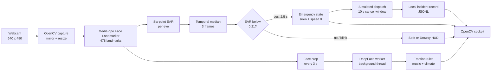

# AI-CoPilot

**Real-time driver monitoring and automotive safety simulation, powered by a laptop webcam.**

AI-CoPilot turns a webcam into a smart-car cockpit. It tracks the driver's face with
MediaPipe, measures eye openness using the Eye Aspect Ratio (EAR), reads facial emotion
with DeepFace, and uses those signals to drive a live OpenCV dashboard. Prolonged eye
closure latches an emergency stop, sounds a siren, and starts a local simulated
emergency-dispatch workflow with a cancellation window and configured location.


*Live cockpit: face tracking, Eye Aspect Ratio, simulated vehicle state, emotion-aware
music, and smart climate control.*

> [!WARNING]
> AI-CoPilot is an educational computer-vision simulation. It is **not** a certified
> drowsiness-detection device, advanced driver-assistance system (ADAS), or substitute
> for a rested driver. Do not connect it to a real vehicle's controls.

> [!IMPORTANT]
> The emergency-dispatch workflow is a **local simulation**. AI-CoPilot does not call
> public emergency services, connect to a telephone network, send SMS, or transmit your
> location or camera imagery anywhere. It reads the location you configure, displays
> the simulated dispatch, and writes a local incident record. It cannot summon help.

---

## Overview

The project demonstrates the core feedback loop of a camera-based driver-monitoring
system:

1. **Perceive** — capture frames and locate facial landmarks.
2. **Interpret** — convert landmarks into an EAR signal and facial emotion into cabin
   preferences.
3. **Decide** — apply temporal filtering and safety state machines.
4. **Act** — update the simulated cockpit, audio, climate control, and emergency
   workflow.

Everything runs locally on the laptop. No camera frame is recorded or uploaded.

## Table of contents

- [At a glance](#at-a-glance)
- [Screenshots](#screenshots)
- [Architecture](#architecture)
- [Engineering analysis](#engineering-analysis)
- [Quick start](#quick-start)
- [Configuration](#configuration)
- [Troubleshooting](#troubleshooting)
- [Safety, privacy, and limitations](#safety-privacy-and-limitations)
- [Scaling to production](#scaling-to-production)
- [Project structure](#project-structure)
- [Contributing](#contributing)
- [Acknowledgements](#acknowledgements)

---

## At a glance

| Area | Technique | Default behaviour |
|---|---|---|
| Face tracking | MediaPipe Face Landmarker, 478-point mesh | Face box and vision HUD |
| Drowsiness | Six-point Eye Aspect Ratio + three-frame median | `EAR < 0.21` for `2.5 s` latches the alarm |
| Emotion | DeepFace seven-class classifier | Background scan at most every `3 s` |
| Cabin response | Rule-based emotion mapping | Upbeat/relaxing music; AC `22 °C → 20 °C` under stress |
| Emergency | Latched safety state machine | Siren, red UI, speed `0`, `Emergency Stop` |
| Dispatch | Local timer and incident logger | `10 s` cancel window; local JSONL record |
| Platform | Python desktop application | Windows, macOS, or Linux with a webcam |

The simulated cruise caps at **72 km/h**. A short blink does not trigger the alarm: the
closure timer only starts once the median-filtered EAR stays below the threshold. After
a full 2.5 seconds of closure, the emergency state remains latched until **R** is pressed.

---

## Screenshots

The image at the top shows the normal cockpit state: face lock, open eyes, `Safe` status,
simulated cruise, 22 °C AC, and emotion-aware music.

The emergency workflow is shown below. Both screenshots use the demo location configured
for this project; no real call is placed.

| 10-second cancellation window | Simulated dispatch completed |
|---|---|
|  |  |

**Left:** the red emergency overlay, zero speed, configured location, and countdown.
Press **C** to cancel. **Right:** the countdown completed, a local case ID was generated,
and the dispatch is marked as simulated.

---

## Architecture



The render loop never waits for DeepFace. A single background worker receives the newest
face crop, so slower emotion inference cannot freeze the camera or the dashboard.

---

## Engineering analysis

### 1. Eye Aspect Ratio and blink rejection

For each eye, AI-CoPilot uses six MediaPipe landmarks: one at each corner and two on
each eyelid.

```text
EAR = (||p2 - p6|| + ||p3 - p5||) / (2 * ||p1 - p4||)
```

With an open eye, the vertical distances are large and EAR typically falls around
`0.25–0.35`. As the eyelid closes, the numerator collapses toward zero. The pipeline
applies a median over the last three frames to reject single-frame landmark jitter,
then compares the filtered value with a configurable threshold. The default is `0.21`.

The two-stage decision is deliberate:

- **Blink rejection:** a normal blink is over before the 2.5-second closure timer
  expires.
- **Microsleep detection:** sustained closure crosses the threshold and latches the
  emergency state.
- **Manual reset:** releasing the wheel or briefly opening the eyes does not silently
  clear an emergency. The driver must press **R**.

### 2. Emotion-aware cabin policy

DeepFace returns probabilities for happy, sad, angry, neutral, fear, disgust, and
surprise. AI-CoPilot maps those classes to cabin actions:

| Emotion signal | Cabin response |
|---|---|
| Happy | `Upbeat Music Playing` |
| Sad or angry | `Relaxing Music Playing` |
| Neutral, surprise, or no fresh result | Focus/ambient playlist or `Audio Standby` |
| Angry, fear, disgust, or high angry/fear score | Stress proxy enables AC target `20 °C` |
| Expression clears | AC target returns to `22 °C` |

DeepFace has no dedicated stress class. Fear and disgust are therefore treated as
**documented stress proxies**, not clinical measurements. The dashboard shows the
dominant emotion and confidence so the signal remains transparent.

### 3. Asynchronous inference

DeepFace can take a noticeable fraction of a second on CPU. The design keeps the
interactive loop responsive:

- Face detection and EAR run on the render path because they are fast.
- Emotion analysis runs on a background thread.
- Only the latest crop is queued; stale requests are dropped.
- Emotion results are only treated as fresh for a short window, so an old label cannot
  drive the cabin indefinitely.

### 4. Emergency state machine

| Input | System response |
|---|---|
| Face present, eyes open | `Safe`; simulated cruise continues |
| Face absent | `No Driver`; no alarm, HUD reports searching |
| EAR low for 0.4–2.5 s | `Drowsy`; amber warning and closure countdown |
| EAR low for 2.5 s | Siren loops, dashboard flashes red, speed set to 0, `Emergency Stop`, `PULLING OVER` overlay, dispatch countdown starts |
| **C** during dispatch countdown | Simulated call cancelled; alarm and emergency stop remain active |
| **R** after an emergency | Alarm stopped, state machine and dispatch cleared, cruise resumes from 0 |

The emergency state is intentionally **latched**. This mirrors a pull-over workflow:
the system does not assume that a driver who briefly opens their eyes is fit to continue.

### 5. Failure handling

| Failure | Observed behaviour |
|---|---|
| Camera unavailable | `CAMERA OFFLINE`; no face, no false alarm; dispatch timer still runs if an emergency is already active |
| DeepFace unavailable | Drowsiness detection continues; emotion panel reports the error; `--no-emotion` reduces load |
| Audio device unavailable | Visual alarm continues; dashboard shows `SOS AUDIO OFFLINE` |
| Missing emergency profile | Template is created; location is flagged as unconfigured |
| Invalid coordinates or delay | Coordinates are ignored or clamped; dispatch remains simulated |
| Camera drops during countdown | Countdown continues and the local incident can still be recorded |

### 6. Representative live observations

These values are indicative, not a controlled benchmark:

| Observation | Value |
|---|---|
| Render rate during a live demo | ~15–17 FPS at 640×480 |
| Open-eye EAR in the captured run | ~0.33 |
| Simulated cruise cap | 72 km/h |
| Alarm arming delay | 2.5 s of sustained closure |
| Simulated dispatch window | 10 s, cancellable with **C** |

Performance depends on CPU, camera resolution, lighting, and whether DeepFace is
enabled. MediaPipe and OpenCV are the main sources of per-frame cost; DeepFace is the
heaviest component but is isolated on its worker thread.

---

## Quick start

### Requirements

- Windows, macOS, or Linux with a webcam and audio output.
- **Python 3.10–3.12** (tested with **Python 3.12.10**; MediaPipe does not currently
  publish wheels for Python 3.13/3.14).
- Internet access on the first DeepFace run to download model weights.
- A reasonably modern CPU. The app can run with `--no-emotion` on lower-spec machines.

Pinned dependencies are in [`requirements.txt`](requirements.txt):

```text
opencv-python==5.0.0.93
mediapipe==1.1.1
deepface==0.0.103
numpy==2.5.4
pygame==2.6.1
werkzeug==3.1.9
```

### Installation

From the repository root.

**Windows (Command Prompt)**

```bat
py -3.12 -m venv .venv
.venv\Scripts\activate
python -m pip install --upgrade pip
python -m pip install -r requirements.txt
```

**Windows (PowerShell)**

```powershell
py -3.12 -m venv .venv
.\.venv\Scripts\Activate.ps1
python -m pip install --upgrade pip
python -m pip install -r requirements.txt
```

If PowerShell blocks activation, call the interpreter directly:

```powershell
.\.venv\Scripts\python.exe -m pip install -r requirements.txt
```

**macOS / Linux**

```bash
python3.12 -m venv .venv
source .venv/bin/activate
python -m pip install --upgrade pip
python -m pip install -r requirements.txt
```

### Run

Windows:

```bat
.venv\Scripts\python.exe copilot.py
```

macOS / Linux:

```bash
.venv/bin/python copilot.py
```

The first start can take longer while MediaPipe and DeepFace initialize. The Face
Landmarker model is bundled in `assets/` and re-downloaded only if missing. DeepFace
downloads its emotion weights on the first scan and caches them locally. Wait for the
emotion panel to leave `Calibrating...`, then look directly at the camera.

### Controls

| Key | Action |
|---|---|
| **Q** or **Esc** | Quit |
| **C** | Cancel the pending simulated emergency dispatch; the alarm stays active |
| **R** | Reset after an emergency stop, clear dispatch state, and resume the simulation |

### Optional arguments

```bat
.venv\Scripts\python.exe copilot.py --help
```

| Flag | Purpose |
|---|---|
| `--camera 1` | Select another camera if index 0 is the wrong or virtual device |
| `--ear-threshold 0.21` | Tune eye-closure sensitivity |
| `--drowsy-seconds 2.5` | Change the sustained-closure alarm delay |
| `--no-emotion` | Disable DeepFace to reduce CPU and memory use |
| `--mute` | Keep the visual alarm but disable the siren |
| `--no-mirror` | Show the raw, unmirrored webcam feed |

---

## Configuration

The dispatch profile lives in `emergency_config.json` in the project root. If the file
is missing, AI-CoPilot creates it from a template on startup.

```json
{
  "driver_name": "Driver",
  "location": {
    "label": "Home",
    "address": "221B Baker Street, London",
    "latitude": 51.52377,
    "longitude": -0.15853
  },
  "dispatch_delay_seconds": 10
}
```

Use a street address or recognizable landmark. Coordinates are optional, but latitude
and longitude must be supplied together. The address is considered unconfigured while
the template text remains and no coordinates are set; the dashboard then shows
`LOCATION NOT CONFIGURED` in amber.

Validation rules:

- Latitude must be in `-90..90`.
- Longitude must be in `-180..180`.
- The dispatch delay is clamped to `1–60` seconds.
- The configured delay does not remove the cancellation control.

When a simulated dispatch completes, the app appends a record to
`incidents/emergency_incidents.jsonl`. Each record includes the timestamp, case ID,
driver, reason, location, coordinates, simulated mode, and
`"real_emergency_call_placed": false`.

Both `emergency_config.json` and `incidents/` are excluded by `.gitignore` because they
can contain private location data.

---

## Project structure

```text
AI-CoPilot/
|-- copilot.py                 # capture, AI, dispatch state machine, audio, OpenCV UI
|-- emergency_config.json      # local driver/location profile (private, gitignored)
|-- README.md
|-- requirements.txt
|-- .gitignore
|-- assets/
|   |-- face_landmarker.task   # MediaPipe Face Landmarker model (~3.6 MB)
|   `-- alarm.wav              # two-tone siren, generated on first alarm startup
|-- docs/
|   `-- screenshots/           # README screenshots
|       |-- dashboard-safe.png
|       |-- emergency-countdown.png
|       `-- emergency-dispatched.png
|-- incidents/
|   `-- emergency_incidents.jsonl  # local simulated-dispatch records (private)
`-- .venv/                     # Python 3.12 virtual environment
```

---

## Troubleshooting

| Symptom | Fix |
|---|---|
| `Could not open camera index 0` | Try `--camera 1`, close other camera apps, check Windows camera privacy settings. |
| Emotion stays on `Calibrating...` | The first DeepFace model load can be slow. Check the console and internet access for the initial download. |
| `MediaPipe Face Landmarker could not start` | Confirm Python 3.12, reinstall `mediapipe`, and make sure `assets/face_landmarker.task` exists. |
| No alarm audio | Check the output device and volume. The dashboard shows `SOS AUDIO OFFLINE` if Pygame cannot open an audio device. Use `--mute` to suppress audio only. |
| False drowsiness alerts | Improve front lighting, remove strong backlight, and try a lower `--ear-threshold` such as `0.18`. |
| Alarm never fires | Raise `--ear-threshold` slightly (up to about `0.24`) and verify the HUD shows a plausible EAR while your eyes are open. |
| Very low frame rate | Use `--no-emotion`, close CPU-heavy apps, and keep the camera at 640×480. |
| `LOCATION NOT CONFIGURED` on the emergency screen | Edit `emergency_config.json` and replace the template address, or add valid coordinates, then restart. |
| No incident record after the countdown | Confirm the project folder is writable and check for `[dispatch] Could not write incident log`. |
| ONNX/DeepFace import error on Windows | Install the Microsoft Visual C++ Redistributable, recreate the venv with Python 3.12, and reinstall the requirements. Use `--no-emotion` while troubleshooting. |

---

## Safety, privacy, and limitations

- **No real dispatch.** The emergency feature is a UI simulation and local logger. It
  does not contact emergency services, send messages, or share your location with any
  server or person.
- **Local processing.** Video frames are consumed in memory only. AI-CoPilot does not
  record, save, or transmit camera imagery.
- **Local profile and logs.** `emergency_config.json` stores the location you provide.
  Completed simulated dispatches append that location and a case ID in plain text to
  `incidents/emergency_incidents.jsonl`. Both are gitignored; protect and delete them as
  private local data.
- **Model downloads.** DeepFace downloads public model weights on first use. After that,
  emotion analysis is local. The MediaPipe model is bundled in `assets/`.
- **Probabilistic emotion.** Facial-emotion classifiers are sensitive to lighting,
  culture, pose, and individual expression. Treat the result as an approximate signal
  for a simulation, not a truth about a person's mental state.
- **Not safety-certified.** Do not use AI-CoPilot for real driving, employment, medical,
  or safety-critical decisions. A production system needs validated sensors, redundant
  measurements, field testing, privacy review, and regulatory compliance.
- **Real emergency integration.** A production emergency feature would need a regulated
  dispatch partner, explicit consent, location accuracy guarantees, failover, and an
  auditable escalation policy.

---

## Scaling to production

AI-CoPilot is a local prototype. A production driver-monitoring and emergency-response
system would need substantially more engineering:

| Layer | This prototype | Production direction |
|---|---|---|
| Sensing | Single RGB webcam | Infrared camera, head-pose, gaze, steering, and vehicle signals |
| Drowsiness model | Fixed EAR threshold | Driver-specific calibration and sensor fusion |
| Emotion model | Seven-class DeepFace scan | Validated affect model with confidence calibration and bias testing |
| Compute | CPU, background thread | Edge accelerator with latency and thermal budgets |
| Decision logic | Rule-based state machine | Fail-operational policy engine with redundant inputs |
| Driver alerts | Dashboard + siren | Multi-modal HMI: audio, haptics, seat/steering cues |
| Dispatch | Local simulation and JSONL | Regulated eCall/telematics integration with two-way confirmation |
| Privacy | Local files, gitignored | Encryption, retention limits, access control, and audit trails |
| Validation | Demo runs | Field data, false-positive/negative analysis, and safety review |
| Reliability | Single process | Watchdogs, failover, health monitoring, and incident replay |

The prototype deliberately stops at the safety boundary: it shows the interaction and
state-management patterns, while avoiding any claim of real emergency capability.

---

## Contributing

Issues and suggestions are welcome.

1. Fork the repository.
2. Create a focused feature branch.
3. Keep changes small and documented.
4. Run `python -m py_compile copilot.py` before opening a pull request.
5. Describe the test conditions and any safety implications in the PR.

When reporting vision issues, include lighting conditions, camera resolution, platform,
and the observed EAR values. Do not upload images of people without their consent.

---

## Acknowledgements

- [MediaPipe](https://developers.google.com/mediapipe) — Face Landmarker and facial mesh.
- [OpenCV](https://opencv.org/) — capture, rendering, and image processing.
- [DeepFace](https://github.com/serengil/deepface) — facial emotion analysis.
- [Pygame](https://www.pygame.org/) — local alarm audio.
- The screenshots use a demo location and are included for documentation only.

---

*AI-CoPilot — educational driver-safety simulation. Drive rested.*
